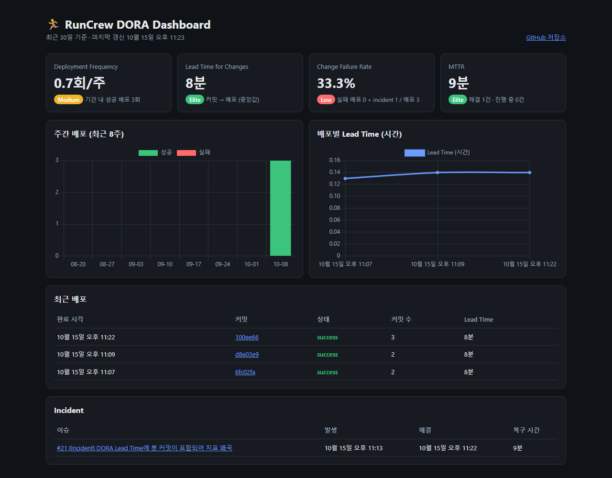

# 🏃 RunCrew

> 함께 달리는 러닝 동기부여 앱: GPS 트래킹, 실시간 그룹 러닝, 포인트 보상


📋 [칸반 보드 (GitHub Project)](https://github.com/users/HC1ab/projects/1) · [마일스톤](https://github.com/HC1ab/example_RunCrew/milestones) · [이슈](https://github.com/HC1ab/example_RunCrew/issues) · [제안서](https://github.com/HC1ab/example_RunCrew/issues/1) · [Wiki](https://github.com/HC1ab/example_RunCrew/wiki) · [Discussions](https://github.com/HC1ab/example_RunCrew/discussions) · [릴리스](https://github.com/HC1ab/example_RunCrew/releases)

## 📌 프로젝트 소개

혼자 달리면 동기가 쉽게 떨어지고, 기존 러닝 앱은 기록 위주라 **함께 달리는 경험**이 부족합니다.
RunCrew는 크루원과 실시간으로 함께 달리고, 달린 만큼 보상을 받아 **꾸준한 러닝 습관**을 만들도록 돕습니다.

## 🎯 문제 정의

- 혼자 하는 러닝은 지속성이 낮음
- 기존 앱(Nike Run Club, Strava 등)은 실시간 그룹 러닝 기능이 제한적
- 꾸준히 달려도 실질적인 보상이 없어 동기 부여가 약함

## ✨ 핵심 기능

| 기능 | 설명 |
|------|------|
| 📍 GPS 러닝 트래킹 | 페이스, 거리, 칼로리 실시간 측정 및 백그라운드 트래킹 |
| 👥 실시간 그룹 러닝 | WebSocket 기반으로 크루원 위치와 페이스 공유 |
| 🎁 포인트 보상 | 러닝 거리에 따른 포인트 적립 및 샵에서 사용 |

## 🛠 기술 스택

| 구분 | 기술 |
|------|------|
| Frontend | Flutter (Dart), Riverpod, Dio |
| Backend | Firebase (Authentication, Cloud Functions) |
| Database | Firebase Realtime Database, Cloud Firestore |
| Deployment | Firebase App Distribution, Google Play 내부 테스트 트랙 |
| CI/CD | GitHub Actions |

## 📊 DORA Metrics

GitHub Actions가 DORA 4대 지표를 자동으로 수집하고, Chart.js 대시보드로 보여줍니다.

👉 **[대시보드 바로가기](https://hc1ab.github.io/example_RunCrew/)** · [원본 데이터 (dora-metrics 브랜치)](https://github.com/HC1ab/example_RunCrew/tree/dora-metrics)



| 지표 | 계산 방식 | 데이터 출처 |
|------|-----------|-------------|
| Deployment Frequency | 최근 30일 성공 배포 수 (주당 평균) | GitHub Deployments (`github-pages`) |
| Lead Time for Changes | 커밋 작성 → 해당 커밋이 포함된 배포 성공 (중앙값, 지표 갱신 커밋 제외) | Deployments + Compare API |
| Change Failure Rate | (실패 배포 + `incident` 이슈) / 전체 배포 | Deployments + Issues |
| MTTR | `incident` 이슈 생성 → 닫힘 (평균) | Issues |

## ⚙️ CI/CD

[](https://github.com/HC1ab/example_RunCrew/actions/workflows/ci.yml)

```
Detect changes ─┬─ code 변경 → Lint → Test (Matrix 9개) ─┐
                └─ site 변경 ────────────────────────────┴→ Build → Deploy → Notify (Discord)
                                                            (main만)   └→ DORA Metrics
문서만 변경 → 위 단계 모두 생략, CI Result만 통과

Test Matrix = Node 20 / 22 / 24 × Ubuntu / Windows / macOS
              − macOS + Node 20 (exclude)  + Ubuntu + Node current (include, experimental)
```

| 구성 요소 | 파일 | 역할 |
|-----------|------|------|
| 메인 파이프라인 | [`ci.yml`](.github/workflows/ci.yml) | 변경 감지 → Lint → Test → Build(`site`·`coverage` 아티팩트 업로드) → Deploy(아티팩트 다운로드 후 Pages 배포) → Notify → CI Result |
| Reusable Workflow | [`reusable-node-test.yml`](.github/workflows/reusable-node-test.yml) | OS·Node 목록을 입력으로 받는 Matrix 테스트 |
| Composite Action | [`setup-node-project`](.github/actions/setup-node-project/action.yml) | Node 설치 + 의존성 캐시 + `npm ci` (캐시 적중 시 설치 생략) |
| DORA 수집 | [`dora-metrics.yml`](.github/workflows/dora-metrics.yml) | main 배포 완료, `incident` 이슈 변경, 매일 00:00 UTC, 수동 실행 시 지표 수집 |
| 이슈 자동 응답 | [`issue-auto-respond.yml`](.github/workflows/issue-auto-respond.yml) | 새 이슈에 안내 댓글, 외부 기여자 이슈에 `status: triage` 라벨 |
| SLA 추적 | [`sla-tracker.yml`](.github/workflows/sla-tracker.yml) | 6시간마다: 첫 응답 48시간 초과 이슈, 리뷰 24시간 초과 PR에 `status: sla-breached` |
| 주간 요약 | [`weekly-summary.yml`](.github/workflows/weekly-summary.yml) | 매주 월요일 09:00(KST): 이슈·PR·incident·SLA·DORA 요약 이슈 생성 (`report` 라벨) |

- **선택적 실행**: 코드(`scripts/`, `test/`, `package*.json`, 워크플로우)가 바뀌면 Lint·Test, 대시보드(`dashboard/`)가 바뀌면 Build·Deploy만 실행합니다. 문서만 바뀐 PR은 테스트를 건너뜁니다.
- **선택적 배포**: main push이면서 빌드가 성공하고 코드나 대시보드가 바뀌었을 때만 배포합니다. 그래서 DORA **Deployment Frequency**는 "실제 변경이 배포된 횟수"만 셉니다.
- **브랜치 보호용 체크**: `CI Result` 하나만 필수 체크로 걸면 됩니다. 일부 job이 skipped여도 실패가 없으면 통과합니다.
- **Secret**: 배포 알림은 `DISCORD_WEBHOOK_URL` Secret으로 주입합니다. Secret이 없으면 알림 단계를 건너뜁니다.
- **최적화 측정 결과**: [CI 최적화 전후 비교 리포트](docs/ci-optimization-report.md)
- 코드: [`scripts/dora/`](scripts/dora/) (지표 계산·수집), [`dashboard/index.html`](dashboard/index.html) (Chart.js 대시보드), [`test/`](test/) (단위 테스트)

## 📂 프로젝트 구조

```
lib/
├── core/            # 네트워크, 스토리지, 상수, 유틸
├── common/widgets/  # 공통 위젯
└── features/
    ├── auth/        # 로그인/회원가입
    ├── running/     # GPS 러닝 트래킹
    ├── group_run/   # 실시간 그룹 러닝
    ├── point/       # 포인트 적립
    └── shop/        # 포인트 샵
```

## 🗓 마일스톤 (16주)

| 기간 | 단계 | 주요 작업 |
|------|------|-----------|
| W1–4 | 기획, 설계, 초기 세팅 | 제안서, PRD, 와이어프레임, Git/GitHub 환경, 프로젝트 구조 설계 |
| W5–8 | 핵심 기능 구현, MVP | 로그인, GPS 러닝 트래킹, 기록 저장/조회, 🚩 W8 중간 발표 |
| W9–12 | 고도화, 추가 기능, 테스트 | 크루 생성/참여, 실시간 위치·페이스 공유, 포인트 적립, 테스트 코드 작성 |
| W13–16 | 최적화, 문서화, 최종 발표 | 포인트 샵, 성능 개선, 배포, README·ADR 문서화, 🏁 W16 최종 발표 |

> 📋 상세 제안서: [#1 프로젝트 제안서](https://github.com/HC1ab/example_RunCrew/issues/1)

## 🚀 시작하기

```bash
git clone https://github.com/HC1ab/example_RunCrew
cd example_RunCrew
flutter pub get
flutter run
```

## 👤 팀원

| 이름 | 역할 | GitHub |
|------|------|--------|
| 황세인 | 디자인 / 개발 | [@HC1ab](https://github.com/HC1ab) |

## 🤝 기여하기

이슈와 PR은 언제나 환영합니다. 시작하기 전에 아래 문서를 읽어 주세요.

- [기여 가이드 (CONTRIBUTING)](CONTRIBUTING.md): 브랜치 전략, Conventional Commits, PR 절차
- [코드 리뷰 가이드](docs/REVIEW_GUIDE.md): `[MUST]` / `[SHOULD]` / `[NITS]` 피드백 태그
- [행동 강령 (CODE_OF_CONDUCT)](CODE_OF_CONDUCT.md)
- [기술 결정 기록 (ADR)](docs/adr/README.md): 주요 설계 결정과 그 이유
- [라이선스 비교 분석](docs/oss/license-analysis.md) · [Inner Source 도입 로드맵](docs/oss/inner-source-roadmap.md)

## 📄 License

[MIT License](LICENSE)
