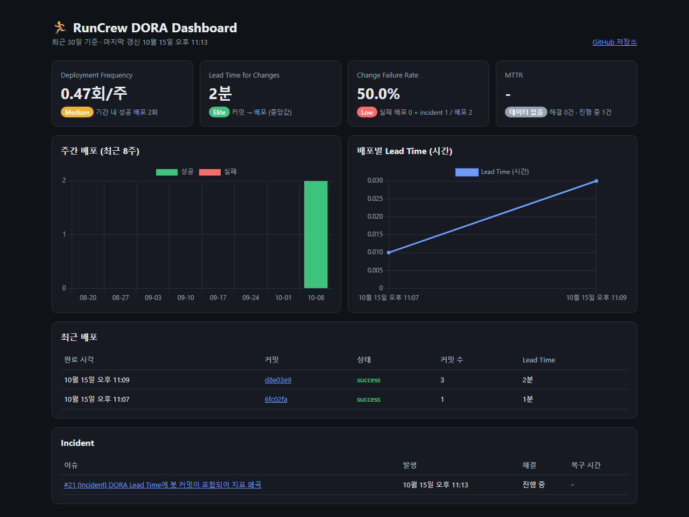

# 🏃 RunCrew

> 함께 달리는 러닝 동기부여 앱: GPS 트래킹, 실시간 그룹 러닝, 포인트 보상


📋 [칸반 보드 (GitHub Project)](https://github.com/users/HC1ab/projects/1) · [마일스톤](https://github.com/HC1ab/example_RunCrew/milestones) · [이슈](https://github.com/HC1ab/example_RunCrew/issues) · [제안서](https://github.com/HC1ab/example_RunCrew/issues/1)

## 📌 프로젝트 소개

혼자 달리면 동기가 쉽게 떨어지고, 기존 러닝 앱은 기록 위주라 **함께 달리는 경험**이 부족합니다.
RunCrew는 크루원과 실시간으로 함께 달리고, 달린 만큼 보상을 받아 **꾸준한 러닝 습관**을 만들도록 돕습니다.

## 🎯 문제 정의

- 혼자 하는 러닝은 지속성이 낮음
- 기존 앱(Nike Run Club, Strava 등)은 실시간 그룹 러닝 기능이 제한적
- 꾸준히 달려도 실질적인 보상이 없어 동기 부여가 약함

## ✨ 핵심 기능

| 기능 | 설명 |
|------|------|
| 📍 GPS 러닝 트래킹 | 페이스, 거리, 칼로리 실시간 측정 및 백그라운드 트래킹 |
| 👥 실시간 그룹 러닝 | WebSocket 기반으로 크루원 위치와 페이스 공유 |
| 🎁 포인트 보상 | 러닝 거리에 따른 포인트 적립 및 샵에서 사용 |

## 🛠 기술 스택

| 구분 | 기술 |
|------|------|
| Frontend | Flutter (Dart), Riverpod, Dio |
| Backend | Firebase (Authentication, Cloud Functions) |
| Database | Firebase Realtime Database, Cloud Firestore |
| Deployment | Firebase App Distribution, Google Play 내부 테스트 트랙 |
| CI/CD | GitHub Actions |

## 📊 DORA Metrics

GitHub Actions가 DORA 4대 지표를 자동으로 수집하고, Chart.js 대시보드로 보여줍니다.

👉 **[대시보드 바로가기](https://hc1ab.github.io/example_RunCrew/)** · [원본 데이터 (metrics/dora.json)](metrics/dora.json)



| 지표 | 계산 방식 | 데이터 출처 |
|------|-----------|-------------|
| Deployment Frequency | 최근 30일 성공 배포 수 (주당 평균) | GitHub Deployments (`github-pages`) |
| Lead Time for Changes | 커밋 작성 → 해당 커밋이 포함된 배포 성공 (중앙값, 봇 커밋 제외) | Deployments + Compare API |
| Change Failure Rate | (실패 배포 + `incident` 이슈) / 전체 배포 | Deployments + Issues |
| MTTR | `incident` 이슈 생성 → 닫힘 (평균) | Issues |

**자동화 흐름**

```
PR 머지 → Deploy 워크플로우 (GitHub Pages 배포, Deployment 기록)
       → DORA Metrics 워크플로우 (지표 계산 → metrics/dora.json 커밋)
       → 대시보드가 최신 dora.json을 읽어 표시
```

- [`.github/workflows/deploy.yml`](.github/workflows/deploy.yml): main 반영 시 대시보드 배포
- [`.github/workflows/dora-metrics.yml`](.github/workflows/dora-metrics.yml): 배포 완료, `incident` 이슈 변경, 매일 00:00 UTC, 수동 실행 시 수집
- [`scripts/dora-metrics.mjs`](scripts/dora-metrics.mjs): GitHub API로 지표 계산 (외부 의존성 없음)
- [`dashboard/index.html`](dashboard/index.html): Chart.js 대시보드

## 📂 프로젝트 구조

```
lib/
├── core/            # 네트워크, 스토리지, 상수, 유틸
├── common/widgets/  # 공통 위젯
└── features/
    ├── auth/        # 로그인/회원가입
    ├── running/     # GPS 러닝 트래킹
    ├── group_run/   # 실시간 그룹 러닝
    ├── point/       # 포인트 적립
    └── shop/        # 포인트 샵
```

## 🗓 마일스톤 (16주)

| 기간 | 단계 | 주요 작업 |
|------|------|-----------|
| W1–4 | 기획, 설계, 초기 세팅 | 제안서, PRD, 와이어프레임, Git/GitHub 환경, 프로젝트 구조 설계 |
| W5–8 | 핵심 기능 구현, MVP | 로그인, GPS 러닝 트래킹, 기록 저장/조회, 🚩 W8 중간 발표 |
| W9–12 | 고도화, 추가 기능, 테스트 | 크루 생성/참여, 실시간 위치·페이스 공유, 포인트 적립, 테스트 코드 작성 |
| W13–16 | 최적화, 문서화, 최종 발표 | 포인트 샵, 성능 개선, 배포, README·ADR 문서화, 🏁 W16 최종 발표 |

> 📋 상세 제안서: [#1 프로젝트 제안서](https://github.com/HC1ab/example_RunCrew/issues/1)

## 🚀 시작하기

```bash
git clone https://github.com/HC1ab/example_RunCrew
cd example_RunCrew
flutter pub get
flutter run
```

## 👤 팀원

| 이름 | 역할 | GitHub |
|------|------|--------|
| 황세인 | 디자인 / 개발 | [@HC1ab](https://github.com/HC1ab) |

## 📄 License

MIT License
